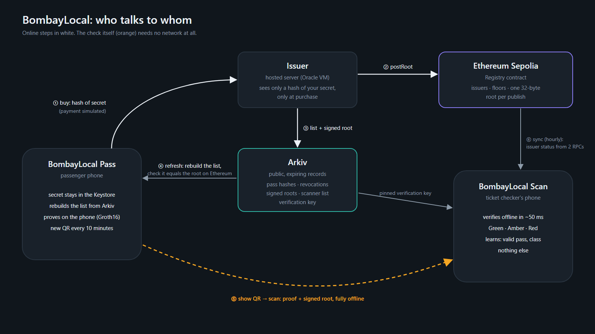

<p align="center"></p>

# BombayLocal

**Offline, private train-pass checks for Mumbai locals.** A passenger's phone proves "I hold a valid pass" with a zero-knowledge proof. The ticket checker's phone verifies it **offline in about 50 ms** and learns one thing: *this pass is valid right now*. No name, no pass ID, nothing that links one scan to the next.

| Try it | Link |
|---|---|
| **Live demo** (two phones in your browser) | https://harshittgupta.github.io/BombayLocal/ |
| **Android apps** (passenger + ticket checker) | [latest release](https://github.com/Harshittgupta/BombayLocal/releases/latest): `bombaylocal-pass.apk`, `bombaylocal-scan.apk` |
| **Live audit** (every public claim, checked in your browser) | https://harshittgupta.github.io/BombayLocal/audit/ |
| **Registry** (Ethereum Sepolia, verified source) | [`0xd13c…5A16`](https://sepolia.etherscan.io/address/0xd13c3d5B02312AEFa4661aD1Fc8205807F255A16) |
| **Hosted issuer** (buying passes only) | https://bombaylocal-issuer.duckdns.org/health |

*Formerly named Unlink.* Protocol identifiers keep that name on purpose, because live data depends on them: the root-signing tag `UNLINK-ROOT-v1`, the Arkiv tags (`app = 'unlink'`, `unlink.signedRoot` …), the Android package IDs `xyz.unlink.*`, the deployed Registry's verified source and the circuit.

## Problem
Mumbai's suburban railway carries millions of commuters a day, and passes are still checked by hand. Our pitch figures: about **9.5 million** daily commuters, **1.86 million** ticketless, roughly **8,000** caught per day, and around **$372,000** in daily fare loss. Checking is slow in a packed coach, and online checks fail where trains lose signal.

Digital passes usually fix speed by adding a server that sees every check. That turns a ticket into a tracking record, and the check still fails without signal.

**The one question:** can a ticket checker know a pass is valid, **offline**, without learning who you are?

## How it works


1. **Buy.** The phone makes a secret, kept by the Android Keystore, and sends only its hash. The payment is **simulated**. The issuer adds `Poseidon(hash, validUntil, class)` to a Merkle tree.
2. **Publish.** About a minute later the issuer posts one 32-byte root to the Registry on Ethereum. It puts the pass hashes, revocations and the signed root on **Arkiv**, as public records that expire.
3. **Refresh.** The phone rebuilds the tree from Arkiv, checks that it equals the root on Ethereum, and finds its own leaf. The issuer is not contacted.
4. **Prove.** The phone makes a Groth16 proof: "my pass is in this tree, valid today, this class". The QR changes every 10 minutes.
5. **Check offline.** The scanner verifies the issuer's signature, the root's expiry and the proof, with no network. The same code shown twice is **Amber**, three times **Red**.

| Measured | Value |
|---|---|
| Circuit | 5,697 constraints |
| Proof on a phone / in a browser | ~3.5 s (pre-made, never at scan time) / 1.3 s |
| Check on the scanner | 50.7 ms median, 0 network requests |
| QR | 427 bytes → 641 Base45 characters → version 16-M |
| `postRoot` | 57,651 gas, one per batch of purchases |
| Buy → pass ready (hosted issuer) | ~60 s |

## Quickstart
Requirements: Node **22.13.1**, JDK **21** + Android SDK (apps), [Foundry](https://getfoundry.sh) (contract), and circom **2.2.3** only to rebuild the circuit. Every command below was run on a fresh clone.

```sh
git clone https://github.com/Harshittgupta/BombayLocal.git && cd BombayLocal
cd protocol  && npm ci && npm test && cd ..          # Poseidon, tree, QR codec, signatures
cd circuits  && npm ci && npm test && cd ..          # real proofs with the committed circuit
cd issuer    && npm ci && npm test && cd ..          # purchases, publishing, limits, CORS
cd web       && npm ci && npm test && npm run build && cd ..   # browser scanner vs all 73 QR fixtures
cd contracts && forge test && cd ..                  # Registry
export ANDROID_HOME=/path/to/Android/Sdk JAVA_HOME=/path/to/jdk-21   # or sdk.dir=… in apps/*/local.properties
cd apps/scanner   && ./gradlew :verifier:test :app:assembleDebug && cd ../..
cd apps/passenger && ./gradlew :app:assembleDebug && cd ../..
node scripts/check-audit.mjs                         # the audit page's checks against live Sepolia + Arkiv
```
Running your own issuer: [`issuer/deploy/README.md`](issuer/deploy/README.md). Exact per-module commands are in [`CLAUDE.md`](CLAUDE.md).

## Demo
- **Browser:**
  1. Open the live demo and buy a pass.
  2. Wait about a minute for the issuer's root on Ethereum.
  3. Drag the checker's phone onto the code: Green. Drag it away and back: Amber, then Red.
- **Android:**
  1. Install both APKs and buy a pass in BombayLocal Pass.
  2. Put that phone in airplane mode.
  3. Show the QR from the lock screen or the notification and scan it with BombayLocal Scan.

## CROPS
- **C (censorship resistance).** Switch the issuer server off and checks still pass. Scanners verify offline, and phones refresh from Arkiv and Ethereum, never from the issuer. Passes keep working until the last root expires (36 h), and every endpoint is editable in Settings.
- **O (open source).** MIT. Both apps, the circuit, the contract, the issuer and the website build from this repo; CI re-checks the circuit artifacts. The contract source is verified on Etherscan, and the APKs are built by GitHub Actions.
- **P (privacy).** The issuer sees a hash and the product at purchase, nothing else. The checker sees validity, class and a 10-minute nullifier. No accounts, analytics or trackers; CI greps for them. Logs carry no IPs.
- **S (security).** The secret is created on the phone, wrapped by the Keystore and excluded from backups. Groth16 proofs; signatures checked offline. The scanner needs two RPC providers to agree before trusting state. Limits are stated below.

## Arkiv
Every pass hash, revocation, signed root, scanner list and the verification key lives on Arkiv, and the passenger app, the scanner and the audit page all read it back.

| Writer wallet | Writes |
|---|---|
| Issuer `0x8d3713FBad1A2E40F40de56D37eab09513cb060B` | SignedRoot, LeafBatch, Revocation, ScannerList |
| Authority `0x153d390680704090AaA24657697f15e6b91Da23f` | VerifyKey |

The issuer's newest signed root:
```sh
curl -s -X POST https://rpc.rabdi.db-chain.testnet.arkiv.network -H 'content-type: application/json' --data \
'{"jsonrpc":"2.0","id":1,"method":"arkiv_query","params":["type = str('"'"'unlink.signedRoot'"'"') AND issuer = addr(0x8d3713FBad1A2E40F40de56D37eab09513cb060B) AND $creator = addr(0x8d3713FBad1A2E40F40de56D37eab09513cb060B) AND $owner = addr(0x8d3713FBad1A2E40F40de56D37eab09513cb060B) ORDER BY rootId:u64 DESC",{"select":{"attributes":true},"limit":"0x1"}]}'
```
More detail: [schema](arkiv/schema.md) · [why Arkiv](arkiv/why-arkiv.md) · [how we use it](arkiv/how-you-use-arkiv.md) · [reach](arkiv/reach.md) · [friction log](arkiv/friction.md).

## Threat model and limitations
The full table is in [SPEC.md §8](SPEC.md). Stated up front:
- **Duplicates are caught per scanner.** A shared screenshot shown to two checkers in the same 10 minutes passes both; uploaded scan batches only *measure* this.
- **Demo-grade trusted setup** (one phase-2 contribution) and an **EOA authority** (a multisig in production).
- **Revocation delay:** a revoked pass works on its old root for up to 36 h, unless the authority raises the floor.
- **Download size:** phones fetch 32 bytes per live pass, about 32 MB at a million. Production needs delta sync.
- **Simulated purchase.** Everything else is real.
- **Lock-screen code:** whoever holds the phone can show it, and an app with notification access can read it (valid for its 10 minutes only).
- **A fresh pass narrows its root:** at low traffic the buyer is briefly alone on the newest root.
- **Testnets only.** The issuer runs on an Oracle Always Free VM that can be paused after 7 idle days.

## Path to production
- **Governance and setup:** a multisig authority and a multi-party trusted-setup ceremony.
- **Scale:** delta leaf sync and tree rotation.
- **Publishing:** a fixed publish cadence (every 15 min) instead of after each purchase.
- **Real use:** a payment integration and an Arkiv access key, then a pilot with one operator.

## AI-use disclosure
Built with **Claude Code** (Anthropic): planning, code, tests, documentation and deployment scripts, module by module. A human reviewed every task. A separate review agent, with fresh context, critiqued each one, and the findings and fixes are logged in [`docs/REVIEWS.md`](docs/REVIEWS.md). The handoffs are in [`docs/HANDOFF.md`](docs/HANDOFF.md).

## License
MIT. See [LICENSE](LICENSE).
